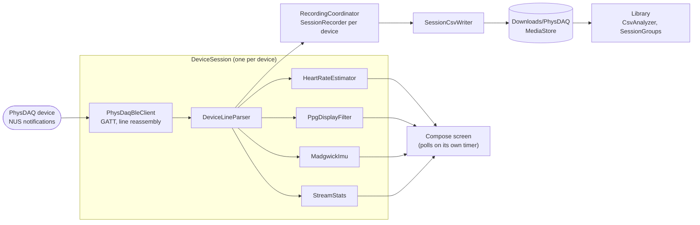

# Android App

`android/` is a native Kotlin app that records from several PhysDAQ devices at
once over Bluetooth LE. It works without the desktop app and the Python bridge:
the phone connects to each device directly, works out heart rate and tilt on the
phone, and writes CSV files that `analysis/pipeline.py` reads unchanged.

**Stack:** Kotlin · Jetpack Compose (Material 3) · Android 10+ (API 29) ·
JVM unit tests (JUnit 4). Package `com.physdaq.mobile`. Developed and tested on a
Samsung Galaxy S22.

The firmware is untouched: the app speaks the same Nordic UART Service (NUS)
text protocol as the bridge (see [protocol.md](protocol.md)). USB is out of scope;
the phone uses Bluetooth only.

> Research instrument, not a medical device. No claim of clinical accuracy.

---

## Screens

The app has two tabs under the logo.

| Tab | What it shows |
|---|---|
| **Live** | Session name and Record/Stop with a timer; the body map; one row per body position (Link / Detail / Kill); the system log (collapsible, fixed height, newest first) |
| **Library** | Every recording on the phone, grouped into sessions; per-node statistics and charts; a Compare nodes chart; Open CSV file for files from elsewhere |

### Live

- **Body positions.** Eight positions, as on the desktop body map: Ear / Head, Chest,
  Left and Right Wrist, Left and Right Finger, Left and Right Ankle. **Link** on a
  position opens a scan list; picking a device connects it and remembers the
  position for that device (by Bluetooth address) across restarts. A position holds
  one device.
- **Body map.** A front-view figure with one dot per position, coloured by status
  (green worn, amber not worn, mauve connecting, grey off, hollow ring = nothing
  linked). The person's left is on the screen's right. Tapping an empty dot links
  it; tapping a linked dot opens its Detail and scrolls to its row.
- **Detail** (one row open at a time). Heart rate, battery, a tilt indicator (a
  spirit level plus roll, pitch and yaw), live filtered PPG and raw IR charts, and
  stream statistics (rate, gap mean/std/max, % bunched packets).
- **Sleep hint.** When a link drops with GATT status 8 (supervision timeout), the
  row shows "Device may have gone to sleep: move it or touch the sensor to wake it"
  until the device reconnects.
- **Pre-record check.** Record first checks every linked position. Anything not
  worn or disconnected is listed with **Record anyway** / **Cancel**; disconnected
  devices are not recorded.

### Library

- **Session list.** Files named like recordings are grouped into sessions by their
  shared timestamp and session name, newest first, showing date, duration, nodes and
  size. Other CSVs (pipeline outputs, files named differently) are listed one per
  row at the end.
- **Session detail.** One card per node: samples, duration, measured rate, longest
  gap, % worn, mean/min/max heart rate; heart rate over time; roll and pitch over
  time (if the file has motion columns); a 10 s filtered PPG window with a slider to
  scrub through the recording.
- **Compare nodes** (sessions with 2+ nodes). Every node's heart rate on one chart,
  aligned to the session clock, with the median and worst difference between nodes.
  Tap or drag to read every node's value at one moment. Each position has a fixed
  colour across all sessions.
- **Open CSV file.** Reads any CSV through the system file picker, without copying
  it. Both the phone layout and the desktop app's 17-column layout are read, by
  column name.
- **Delete** removes a session's files from the phone after a confirmation.

Heart rate and tilt in the Library are recomputed from the CSV with the same code
the Live tab uses, so a replay shows what the live screen would have shown.

---

## Architecture



All acquisition state lives in **`AcquisitionRuntime`**, a process-wide object that
holds the scanner, one `DeviceSession` per device, the recording coordinator, the
log and the body-position assignments. The Activity only draws it, so rotating the
phone or swiping the app away does not touch connections or an open recording.
**`AcquisitionService`** is a foreground service (type `connectedDevice`). It does no
work itself; it exists so Android keeps the process alive with the screen off, and
it carries the notification with a Stop button.

### Code layout (`app/src/main/java/com/physdaq/mobile/`)

| Package / file | Job |
|---|---|
| `ble/` | NUS UUIDs, scanner (filters by NUS service UUID, 20 s timeout), one-device GATT client, line parser, reconnect policy, stream statistics, advertisement hints |
| `dsp/` | `SpectralBpm` + `HeartRateEstimator` (heart rate), `PpgDisplayFilter` (waveform), `MadgwickImu` (tilt) |
| `storage/` | `RecordingFileNames`, `SessionCsvWriter`, `RecordingStorage` (MediaStore), `SessionRecorder` per device, `RecordingCoordinator` |
| `nodes/` | `NodePosition` (the eight positions), `NodeAssignments` + `PrefsStore` (position per device, persisted), `NodeChecks` (sleep hint, pre-record check), `BodyMapLayout` (dot coordinates, tap hit-test) |
| `library/` | `CsvAnalyzer`, `SessionGroups`, `SessionComparison`, `ChartData`, `LibraryRepository` (MediaStore list/open/delete, file picker), `LibraryScreen` |
| `ui/` | `SignalBuffer` + `LiveChart`, `TiltIndicator`, `BodyMapView`, `theme/` (Catppuccin Mocha palette, as on the desktop) |
| `AcquisitionRuntime.kt` | State holder described above |
| `AcquisitionService.kt` | Foreground service described above |
| `DeviceSession.kt` | One connected device and everything derived from its stream |
| `MainActivity.kt` | The Compose screens |

Everything outside `MainActivity`, `LibraryScreen`, the `ui/` composables,
`LibraryRepository`, `PrefsStore`, `RecordingStorage`, the BLE client and the
service is plain Kotlin with no Android types, so it runs in JVM unit tests.

---

## Bluetooth

- **Discovery is by the NUS service UUID, never by name.** The manufacturer data in
  the advertisement is only a hint for the scan list. After connecting, the device's
  `ID` line decides what it is (model, firmware, PPG count, name).
- The client requests an MTU of 247 to match the firmware
  (`CONFIG_BT_L2CAP_TX_MTU=247`), enables notifications on the NUS TX
  characteristic, and reassembles text lines across notifications.
- **Hubs** are read as one sensor: sensor 0 of the hub's sample line. The Detail
  panel says so.
- **Reconnect.** After an unexpected drop the client retries after 1 s, 2 s, 4 s,
  then every 5 s. The cap is low on purpose: a sleeping node only advertises for a
  short time after it is moved.
- **Status 8** (supervision timeout) means the phone stopped hearing the device.
  For a node this is usually deep sleep: no motion above about 0.1 rad/s and no skin
  contact for 10 s. See [hardware.md](hardware.md) for the sleep rules and
  `CONFIG_PHYSDAQ_IDLE_TIMEOUT_SEC`.

### Stream timing

Over Bluetooth the stream arrives at **about 24.3 samples per second**, not the
sensor's 100 Hz. Arrival times are quantised by the connection interval (gaps
cluster near 30 and 60 ms, jitter about 12 ms). Every sample is stamped with
`SystemClock.elapsedRealtimeNanos()` on arrival; there is no device clock. This is
accurate for heart rate but **not for beat-to-beat timing (HRV)**.

---

## Signal processing

### Heart rate (`HeartRateEstimator`, `SpectralBpm`)

Ported from `scripts/bridge.py`, with the sample rate measured instead of assumed.

| Step | Value |
|---|---|
| Contact | mean of the last 30 IR samples > 5000 (same constant as firmware, bridge and pipeline) |
| Window | last 200 samples (about 8 s); cleared when contact is lost |
| Cadence | one estimate every 25 samples (about 1 s) |
| Spectrum | detrend, Hann window, DFT over 0.7–3.0 Hz (42–180 BPM) |
| Acceptance | peak at least 3× the band median, refined with a parabola |
| Sample rate | from the window's own timestamps: (N−1) / (last − first) |
| Smoothing | the shown value moves at most 4 BPM per estimate; dropped after 5 failed estimates in a row |

The first reading needs about 8 s of steady contact. There is no motion
cancellation, so vigorous movement can lock the reading onto the motion rhythm.

### Waveform (`PpgDisplayFilter`)

A band-pass on IR for the "PPG, filtered" chart only. Its sample rate is updated
once a second from the measured stream rate. It is never written to the CSV.

### Tilt (`MadgwickImu`)

Madgwick's 6-axis filter (gyroscope + accelerometer), β = 0.1, started from the
tilt the first accelerometer reading shows. Gaps longer than 0.2 s are stepped over
rather than integrated.

| Angle | Meaning | Trust |
|---|---|---|
| Roll | rotation about X; positive when +Y points up | does not drift |
| Pitch | rotation about Y; positive when +X points down | does not drift |
| Yaw | rotation about Z since the app connected | **drifts**: there is no magnetometer |

Flat and still, gravity reads +Z and roll and pitch are 0. Yaw is shown with an
asterisk and left out of the Library charts.

---

## Recording

### Files

Recordings go to **`Download/PhysDAQ/`** through MediaStore (no storage permission
needed). One file per device:

```
<yyyy-MM-dd_HH-mm-ss>_<session name>_<position>.csv
2026-10-22_12-17-44_PhysDAQ_Session_finger-left.csv
```

- The timestamp comes first, in the same pattern as `analysis/logger.py`, so files
  sort by time and `make process FILE=...` works on any of them.
- The session name defaults to `PhysDAQ_Session`. Anything other than letters,
  digits, `-` and `_` becomes `_`. A blank name leaves just the timestamp.
- The position is what follows the **last** underscore. Position slugs use hyphens
  only: `head`, `chest`, `wrist-left`, `wrist-right`, `finger-left`,
  `finger-right`, `ankle-left`, `ankle-right`. (The desktop app uses underscores in
  its folder layout; the phone does not.)
- A device that was never linked to a position falls back to its name.

### Schema

The logger layout from [protocol.md](protocol.md), unchanged:

```
timestamp,red,ir,ax,ay,az,gx,gy,gz
```

- `timestamp`: float seconds since Record was pressed, 4 decimals. **All files in a
  session share that zero**, so they line up.
- `red`, `ir`: integers as received. `ax..az` in m/s², `gx..gz` in rad/s, 3 decimals.
- Numbers are written with `Locale.ROOT`, so a phone set to a comma-decimal
  language still writes `0.213`.
- Only these nine numeric columns. Heart rate and tilt are derived values and are
  not written; the Library and the pipeline recompute them.

### Two-device timing

Each device's samples are stamped on arrival at the phone, against one shared
origin per session. A first two-finger recording (2026-10-22) put the two files
within about one sample of each other (median 43 ms, from pulse-wave
cross-correlation). Whether that is device timing or the body's left/right pulse
difference is still open; the tap test in [android/tools](../android/tools/README.md)
measures devices only.

---

## Storage caveat: reinstalling

Android lets an app list only the files in `Download/` that **it** created. After an
uninstall or reinstall, older recordings stay on the phone but no longer appear in
the Library list. Open them with **Open CSV file** (the system picker), or copy them
off the phone over USB.

---

## Performance rules

- **No Compose state per sample.** Samples go into ring buffers (`SignalBuffer`);
  charts redraw on their own 40 ms timer, the tilt indicator polls about 8 times a
  second, and heart rate changes at most once a second. Updating UI state at stream
  rate is what froze the desktop app.
- BLE callbacks arrive on binder threads; work is handed to the main thread before
  it touches any state.
- The Library reads files off the main thread and caches each file's analysis while
  the tab is open.

---

## Testing

```bash
cd android
./gradlew test        # JVM unit tests, no phone needed
```

Covered: line parsing, stream statistics, reconnect delays, heart rate (including a
golden comparison with the Python reference on a real recording in
`app/src/test/resources/`), file naming, body positions and assignments, the sleep
and pre-record checks, body-map hit-testing, CSV analysis of both layouts, session
grouping, node comparison, and the tilt filter (also checked against an independent
Python implementation on a real recording).

Not covered: the Compose screens, the BLE client and MediaStore. Those need a phone.

---

## Known limits

| Limit | Why |
|---|---|
| About 24.3 Hz, not 100 Hz | the Bluetooth stream rate; the sensor still samples at 100 Hz |
| HRV not reliable | arrival times are quantised to the connection interval |
| Hub = one sensor | only sensor 0 of a hub's line is read |
| Yaw drifts | no magnetometer; roll and pitch are fine |
| "Worn" can be fooled | contact is an IR level check; a reflective surface at the right distance counts |
| Recordings vanish from the list after a reinstall | Android file ownership; use Open CSV file |
| No markers, notes or sharing yet | see [roadmap.md](roadmap.md) |
